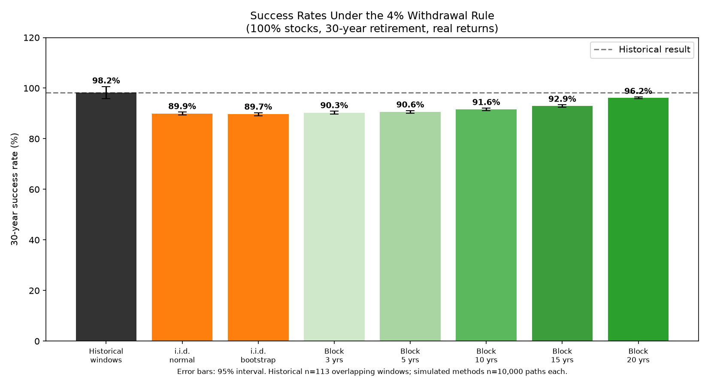
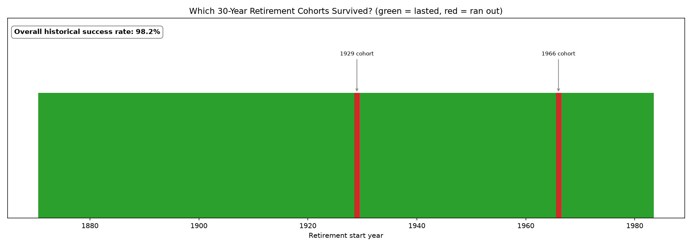
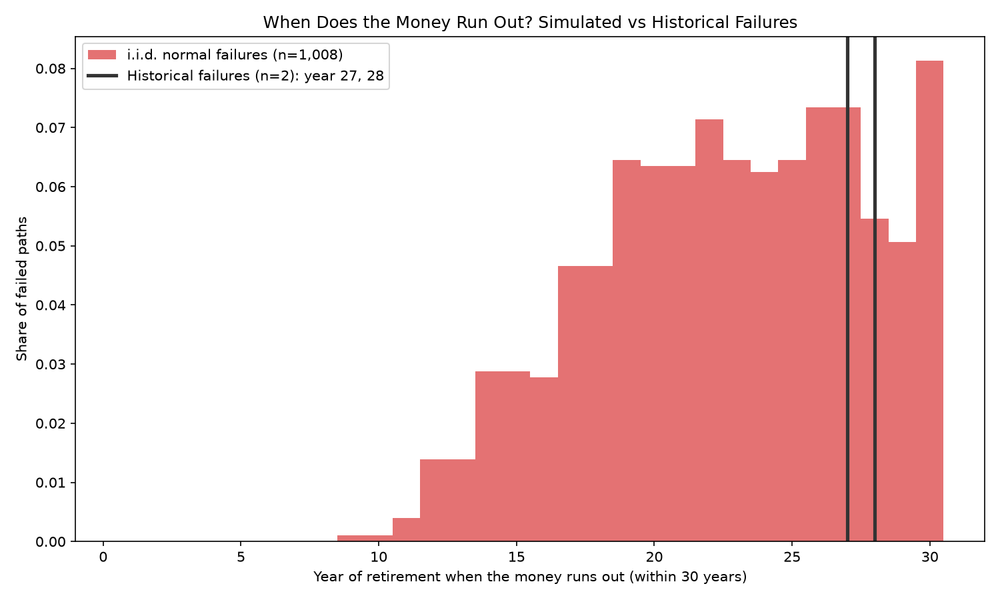

# Retirement Monte Carlo Simulation: The 4% Rule Under Return Clustering

How safe is the 4% retirement rule? History says very safe. Simple simulations say less so. This project asks why, and whether keeping runs of consecutive years together explains part of the gap.

**Paper:** [The 4% Rule Under Return Clustering](paper/4-percent-rule-return-clustering.pdf)

## The question

A retiree starts with \$1,000,000 in 100% U.S. stocks and withdraws \$40,000 a year in today's money for 30 years. The portfolio fails if the balance reaches zero.

Using Robert Shiller's annual real returns (1871 to 2012), I compare:

- **Historical windows:** every real 30-year retirement in the data
- **i.i.d. normal:** each year drawn independently from a normal distribution
- **i.i.d. bootstrap:** each year drawn independently from the real returns
- **Block bootstrap:** blocks of 3, 5, 10, 15 and 20 consecutive real years joined together

## Results

Each simulation uses 10,000 paths with seed 42.

| Method | Paths | Success rate | Failed paths |
|---|---:|---:|---:|
| Historical windows | 113 | 98.23% | 2 |
| i.i.d. normal | 10,000 | 89.92% | 1,008 |
| i.i.d. bootstrap | 10,000 | 89.71% | 1,029 |
| 3-year block bootstrap | 10,000 | 90.30% | 970 |
| 5-year block bootstrap | 10,000 | 90.59% | 941 |
| 10-year block bootstrap | 10,000 | 91.59% | 841 |
| 15-year block bootstrap | 10,000 | 92.91% | 709 |
| 20-year block bootstrap | 10,000 | 96.15% | 385 |

Success rises as blocks get longer. That is consistent with return ordering mattering, but it does not prove it. Historical windows overlap (113 windows are closer to four or five independent periods), long blocks come close to replaying history, and I have not run formal tests of dependence. The paper explains these limits.





## Method in brief

Each year the balance grows by that year's real return, then the withdrawal is taken:

`B_t = B_(t-1) * (1 + r_t) - w`

- Returns are already real, so inflation is not subtracted again.
- Returns are applied before the withdrawal.
- Blocks do not wrap around the end of the data.
- Ending wealth is reported for surviving paths only.

## Project structure

```
build_dataset.py    builds the clean returns table from Shiller's file
swr.py              simulation engine and the eight methods
plots.py            the three figures
run.py              runs everything and prints the results table
tests/test_swr.py   12 automated tests
paper/              the research paper (PDF)
results/            generated figures
```

## How to run

1. Install the requirements: `pip install -r requirements.txt`
2. Download Robert Shiller's `chapt26.xlsx` from his website and place it in `data/raw/`. The data file is not included in this repository.
3. Build the dataset: `python build_dataset.py`
4. Run the experiment: `python run.py`
5. Run the tests: `python -m pytest`

## Data

Annual real S&P Composite prices and dividends from Robert Shiller's long-run data, 1871 to 2012. Real returns are rebuilt as `(P_(t+1) + D_t) / P_t - 1` and checked against the file's own return column (largest difference about 2e-16).

## Limitations

- 100% U.S. stocks, one dataset, one country
- Constant real withdrawal, no taxes, fees or spending flexibility
- Overlapping windows and limited independent history
- No formal tests of autocorrelation or other dependence yet
- One random seed

## License

MIT. See [LICENSE](LICENSE).